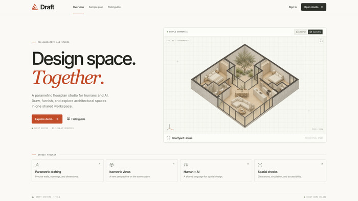

# Draft visual system

The Firecrawl design capture on 2026-11-19 included page text, branding, a full-page desktop screenshot and an image inventory. The screenshot shows a compact navigation bar, a split headline and drawing sheet, four toolkit cards and a ruled footer. The source uses Next.js, Tailwind and custom CSS. [Reference landing page](https://draft-chan.vercel.app/)

The extracted palette uses paper #FAF9F6, ink #252720, terracotta #C24C29, and muted green #748866. Inter sets headings and body copy. app/globals.css supplies IBM Plex Mono for drawing labels and Georgia italic for editorial emphasis. Existing primary buttons have a 5px radius, white text and a terracotta fill. Subtle one-pixel borders divide the page.

The dashboard adaptation keeps the same margins, header, type families, card borders and primary controls. A grid-lined sheet shows each plan's generated geometry. The reference model is reserved for the illustrative Courtyard House sample. The library scrolls internally within a 100dvh shell and reflows to one column on phones. [Model asset](https://draft-chan.vercel.app/isometric.webp)

The landing header has one account action. Signed-out visitors see Sign in and signed-in members see Workspace. The dashboard header contains the Draft brand and Clerk account control. Page layouts run without a site footer.

The sign-in and sign-up forms open in a centered native dialog over the landing. The dialog uses paper, ink, and terracotta for account actions. Auth inputs use 16px text and 44px minimum height. Dialog contents scroll within 100dvh on short screens. Closing the dialog restores focus to its trigger.

Studio uses a full-height architectural drawing surface with a fine olive grid, solid wall strokes, and terracotta active-tool and selection accents. The compact header identifies the floorplan and save state. View and history controls sit above a horizontal drawing and selection toolbar. The inspector sits alongside the canvas on wide screens and opens as an overlay on smaller screens. Canvas pan, zoom, and fit stay within the drawing pane. A terracotta dashed marquee indicates the selection area while dragging.

Catalog fixtures use warm, dimensioned footprints and appear as blocks at their model height in isometric view. Electrical points use outlined rectangles and plumbing points use outlined circles, with independent visibility controls in the Inspector. The Clearance panel pairs each finding with its measurement or collision evidence. Opening a finding centers the plan and uses terracotta outlines or dimension end marks. On compact screens the panel closes when a finding is selected so the highlight remains visible.
